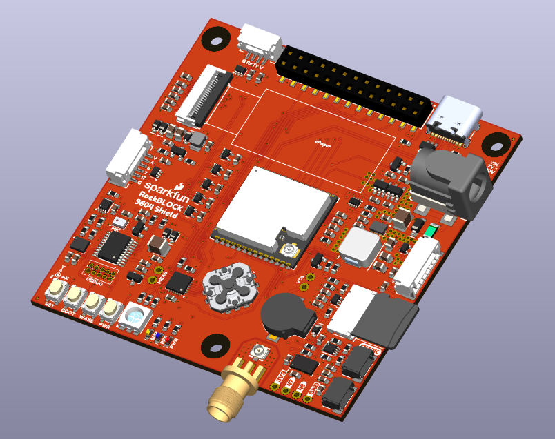

# SparkFun SSD168x Library



A library to support SSD1680/1 e-paper displays on SPI.

This library is based heavily on the [SparkFun Qwiic OLED Arduino Library](https://github.com/sparkfun/SparkFun_Qwiic_OLED_Arduino_Library) and includes the same fonts and graphics support.

It has been tested on the GoodDisplay GDEY0154D67 1.54" (200 x 200) and GDEM0097T61 0.97" (184 x 88) e-paper displays.

Repository Contents
-------------------

* **/examples** - Examples for the Arduino IDE
* **/idf_examples** - Examples for the Espressif ESP32 IDF
* **/src** - Source code

Documentation
--------------

* **[GitHub Repo](https://github.com/sparkfun/TODO)** - TODO: Update URL and description
* **[Hookup Guide](http://docs.sparkfun.com/TODO/)** - TODO: Update URL and description

Notes about SSD1680/1 Ping-Pong Mode
------------------------------------

The GoodDisplay GDEY0154D67 (1.54", 200 x 200, SSD1681) and GDEM0097T61 (0.97", 184 x 88, SSD1680) e-paper displays both use SSD168x Ping-Pong Mode.
If you read the OTP Display Option using command 0x2D, you will find that Bit 6 of Byte F is set, indicating ping-pong mode is enabled.
We believe this is to allow the displays to better support partial updates. The RAM banks are used to identify which pixels have changed from the previous update.
It causes some interesting issues...

If you 'clear' the display - (e.g.) set all the pixels white and do a full update - the white pixels are written to both BW RAM and RED RAM.
GoodDisplay calls this the "BaseMap" or "background color function".
If you then set a group of pixels black and do a _partial_ update, those pixels are displayed - as you would expect.
If you then set a different group of pixels black and do a second _partial_ update, only the second group are displayed - the first group are hidden.
If you then set a third group of pixels black and do a third _partial_ update, the first and third groups are displayed - the second group is hidden.
We believe this is caused by the SSD168x "ping-pong" mode - automatic switching of the RAM banks.

One solution is to re-write all pixels before each partial update. But that takes time.

This library is based on the concept of "dirty pixels". Only pixel areas which have actually changed are written to the display. This means the ping-pong mode can cause some interesting 'blinking' or 'flashing' effects.

Our solution is to record which group(s) of pixels have changed for the current partial update, and to record which group(s) were changed during the previous partial update. The "dirty pixel" areas are expanded to cover both the latest changes (```m_pageState```) and the previous changes (```m_pagePrevious```).

License Information
-------------------

This product is _**open source**_! 

Please review the LICENSE.md file for license information. 

If you have any questions or concerns on licensing, please contact technical support on our [SparkFun forums](https://community.sparkfun.com/c/components-and-accessories/displays/29).

Distributed as-is; no warranty is given.

- Your friends at SparkFun.

_<COLLABORATION CREDIT>_
